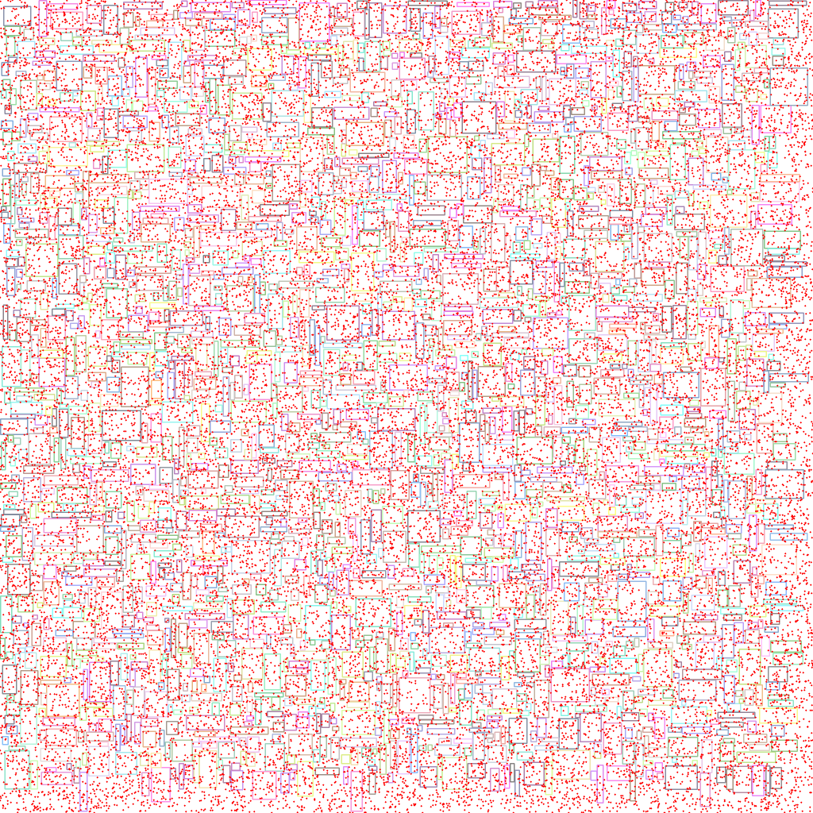

# Polygon point lookup with QuadTree and R-tree

A small C++17 experiment: index OpenCV point polygons and find the polygon containing a query point. The benchmark compares a custom quadtree, Boost.Geometry R-tree, and a linear scan. Polygon boundaries count as hits.

## Build and test

Requires OpenCV 4.9+, Boost headers, Google Test, CMake, and a C++17 compiler. For example, with Clang 21:

```sh
cmake -S . -B build -DCMAKE_BUILD_TYPE=Release -DCMAKE_CXX_COMPILER=clang++-21
cmake --build build
ctest --test-dir build --output-on-failure
./build/speed_test
```

## Benchmark

Fixed seed `12345`, 2121 non-overlapping axis-aligned rectangles accepted from 4096 generation attempts, and 32768 query points. Median of three runs on an Intel Core i7-10750H with Clang 21.1.8 (`-O3`), OpenCV 4.10, and Boost 1.90:

| Operation | QuadTree | R-tree | Linear scan |
| --- | ---: | ---: | ---: |
| Insert all polygons | 3.22 ms | 3.95 ms | — |
| Run all queries | 1097.71 ms | 22.21 ms | 9979.68 ms |

Both indexes matched the linear scan on all 32768 queries in each run, including 19648 hits. Timings varied noticeably across runs; these numbers describe this dataset and machine, not a general ranking of the data structures. The benchmark is headless and does not regenerate the image below.

## Comparison with the original measurements

The original README reported one run. The current values are medians of three runs:

| Operation | Original | Current | Change |
| --- | ---: | ---: | ---: |
| QuadTree insertion | 0.784 ms | 3.22 ms | 4.1× longer |
| R-tree insertion | 1.036 ms | 3.95 ms | 3.8× longer |
| QuadTree queries | 147.2 ms | 1097.71 ms | 7.5× longer |
| R-tree queries | 10.438 ms | 22.21 ms | 2.1× longer |
| Linear scan queries | 1620.97 ms | 9979.68 ms | 6.2× longer |

R-tree was about 14× faster than QuadTree on queries in the original report and about 49× faster in the current run. These are **not controlled before/after measurements**: the original benchmark did not record the accepted polygon count or a random seed, and the generator and timing code have changed. The larger times cannot be attributed to the tree fixes alone.

The original `Mismatches qt: 0` was also unreliable: a typo incremented the R-tree mismatch counter when QuadTree disagreed with the linear scan. The current benchmark fixes that counter and reports zero mismatches for both indexes on all 32768 queries in each run.


